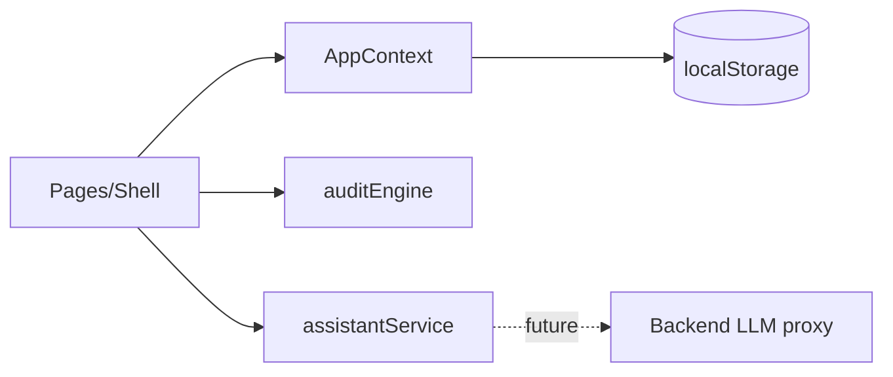

# Architecture
`App.jsx` routes (HashRouter) render pages inside `Shell`. `AppContext` holds all state (rules, drafts, revisions, role), persists to localStorage, and enforces status transitions in `move()`. Services: `auditEngine.js` (pure rules to findings), `assistantService.js` (pure function `reply(question, context)`; swap for a backend call later). Future (not implemented): backend + LLM proxy.

